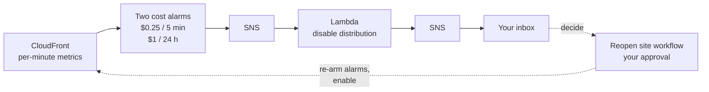

# Cost kill switch

AWS has no hard spending cap. CloudFront bills per request and per GB served,
so a flood of traffic, hostile or not, is the one way this site's bill could
run away. The kill switch takes the site offline when CloudFront's estimated
cost crosses a threshold, and emails you. Nothing turns the site back on except
you.

[`infra/main/killswitch.tf`](../infra/main/killswitch.tf) defines it,
[`api/contact/src/killswitch.ts`](../api/contact/src/killswitch.ts) is the
function, and
[`.github/workflows/reopen-site.yml`](../.github/workflows/reopen-site.yml)
brings the site back.



## How the cost is estimated

CloudFront publishes its request count and bytes served every minute, for free,
in us-east-1. Each alarm turns them into dollars:

```
cost = requests × $0.012 / 10,000  +  bytes out / 10⁹ × $0.085
```

These are the dearest pay-as-you-go rates for the price class (European request
pricing), and the monthly free allowance (10M requests, 1 TB) is ignored. The
estimate is therefore on the high side, so the switch trips early rather than
late. For scale, $1 is about 830,000 requests, or about 12 GB served.

| Alarm                        | Trips at (default)     | Catches                     |
| ---------------------------- | ---------------------- | --------------------------- |
| `portfolio-kill-switch-5min` | $0.25 in any 5 minutes | a flood (~210,000 requests) |
| `portfolio-kill-switch-24h`  | $1 in any 24 hours     | a slow burn                 |

The thresholds and both prices are variables (`kill_switch_fast_usd`,
`kill_switch_daily_usd`, `cloudfront_request_price_per_10k_usd`,
`cloudfront_transfer_price_per_gb_usd`). `kill_switch_enabled = false` removes
all of it.

**Why not AWS Budgets.** A budget works from billing data that lags by hours,
and its actions can only attach IAM policies or stop EC2 and RDS instances, not
touch CloudFront. These alarms react to the traffic itself, within minutes.

## When it fires

1. An alarm goes into `ALARM` and notifies an SNS topic.
2. The function sets the distribution to `Enabled=false`, keeping the rest of
   its configuration unchanged.
3. It emails `budget_alert_email` with the alarm, the reason (including the
   estimated cost that crossed the line), the time, and how to reopen.
4. With no traffic served, the alarm returns to `OK` on its own.

If disabling fails, the email says so, with the subject starting `ACTION
NEEDED`, and tells you how to disable the distribution by hand.

Terraform ignores the distribution's `enabled` after creation, so a later
apply, from any merge, cannot quietly bring the site back.

## Setup

**1. Apply bootstrap first.** The CI apply role needs SNS permissions to create
the topics. Apply `infra/bootstrap` locally before merging the change that adds
the kill switch, as for any new service in `infra/main`
([`oidc.md`](oidc.md#the-three-roles)).

**2. Confirm the subscription.** On the first apply, SNS emails
`budget_alert_email` a confirmation link. Click it, or the notice never
arrives. Check it is confirmed:

```sh
aws sns list-subscriptions --region us-east-1 \
  --query "Subscriptions[?Protocol=='email'].SubscriptionArn"
```

`PendingConfirmation` means the link has not been clicked yet.

## Test it once, on purpose

This takes the site offline for a few minutes. Force the fast alarm into
`ALARM`, which runs the real path end to end:

```sh
aws cloudwatch set-alarm-state --region us-east-1 \
  --alarm-name portfolio-kill-switch-5min \
  --state-value ALARM --state-reason "Manual test of the kill switch"
```

Within a minute you should get the email, and the distribution should show as
disabled. Then reopen the site as described below.

## Reopening the site

Check what happened first: the CloudFront console's Monitoring tab shows the
traffic. Then:

```sh
gh workflow run reopen-site.yml
```

Or open Actions, choose **Reopen site**, then **Run workflow**. The job waits
for your approval of the `infra` environment, then:

1. **Re-arms both alarms** (sets them to `OK`). If the spike is still going,
   the next evaluation trips the switch again.
2. **Enables the distribution** and waits until CloudFront has deployed it,
   which takes a few minutes.

**Then allow up to 15 more minutes.** While the site was off, its name did
not resolve, and resolvers that looked it up cached that answer for the
zone's negative-cache TTL: the lower of the SOA record's TTL and its minimum
field, 900 seconds on Route 53. Your own machine is one of them; flush its
DNS cache to see the site at once (`ipconfig /flushdns` on Windows, which
also serves WSL).

**After the 24-hour alarm trips**, its window still contains the spike for up
to a day. Reopening sooner trips it again. Wait, or raise
`kill_switch_daily_usd` first. The email says so when that alarm is the one
that fired.

## Limits

- **Not instant.** CloudFront's metrics arrive a few minutes late, and
  disabling a distribution takes a few minutes to reach every edge. Expect 5 to
  10 minutes from the start of a flood to the site going dark.
- **Unreachable, not just empty.** A disabled distribution's DNS is
  withdrawn, so the Route 53 alias stops resolving: browsers and bots cannot
  even reach CloudFront, so no requests are served or billed. Observed in the
  first live test (2026-10-24); AWS's pricing pages do not spell it out.
- **CloudFront only.** Lambda, API Gateway, DynamoDB and SES are capped
  differently: the API throttle, the Lambda's concurrency and the per-visitor
  limit ([`contact.md`](contact.md)).
